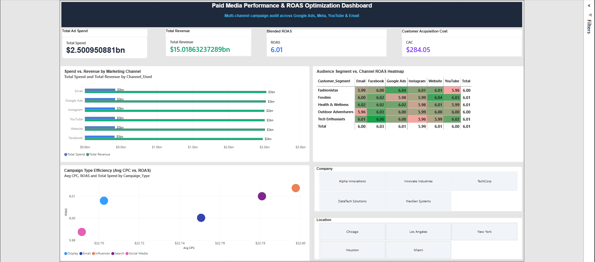

# Paid Media Performance & ROAS Optimization Dashboard

## 📊 Project Overview
This project analyzes **200,000+ paid advertising campaigns** across major digital acquisition channels (Google Ads, Facebook, Instagram, YouTube, Email, and Direct Website) to evaluate spend efficiency, attribution models, and Return on Ad Spend (ROAS). 

The goal is to identify loss-making segments and model strategic budget reallocation to maximize profitability without increasing gross ad spend.

---

## 🛠️ Tech Stack & Analytical Tools
- **Business Intelligence:** Power BI Desktop, Star-Schema Modeling, Interactive Slicing
- **Calculations & DAX:** Dynamic KPI measures (ROAS, CAC, CPC, CTR)
- **Data Preprocessing:** Advanced Excel (Calculated Fields, Normalization)
- **Domain Focus:** Performance Marketing, PPC Attribution, E-Commerce Analytics

---

## 📈 Dashboard Preview


---

## 📐 Key DAX Measures Engineered
- **Blended ROAS:**
  ```dax
  ROAS = DIVIDE([Total Revenue], [Total Spend], 0)
CAC = DIVIDE([Total Spend], [Total Conversions], 0)
Avg CPC = DIVIDE([Total Spend], SUM(marketing_campaign_dataset[Clicks]), 0)
CTR % = DIVIDE(SUM(marketing_campaign_dataset[Clicks]), SUM(marketing_campaign_dataset[Impressions]), 0)
